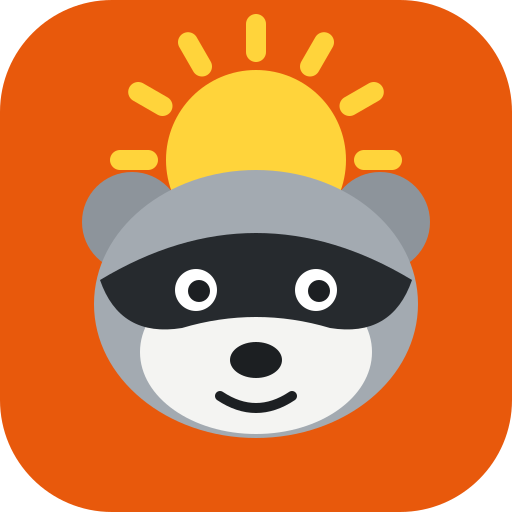

# Daytime Ninja brand



**Idea:** the same masked raccoon as Nighttime Ninja, on the day shift. Where Nighttime Ninja wears a chef hat on a night-green tile, Daytime Ninja has the sun rising behind its head on a sunny orange tile. The two apps sit together as a pair.

## Files

| File | Use |
| --- | --- |
| `daytime-ninja-logo.svg` | Master logo (the app icon tile). |
| `daytime-ninja-logo-small.svg` | Cut for 16–48 px: fewer, thicker sun rays. Used for `favicon.ico`. |
| `concept-a.svg` | Sunrise (chosen). |
| `concept-b.svg`, `concept-c.svg` | Alternatives that were considered: ninja headband with a corner sun, and a kerchief with sparkles. |
| `concepts.png` | Side-by-side review of the three at 256, 64, 32 and 16 px. |

Every icon (web, PWA, favicon, Android sources, Windows, launcher) is generated from `scripts/brand.mjs`:

```bash
npm run icons
```

## Colors

| Role | Hex |
| --- | --- |
| Tile (primary orange) | `#e8590c` |
| Sun | `#ffd43b` |
| Fur | `#a3aab1` / ears `#8d949b` |
| Cheeks | `#f4f4f2` |
| Mask and features | `#262a2e` / `#1c1f22` |

## Use

- Keep the rounded tile; don't put the raccoon on another color square.
- Minimum size 16 px (use the small cut below 48 px).
- Leave at least 1/8 of the tile's width of clear space around it.
- Don't stretch, recolor the raccoon, add shadows or outlines.

The logo was drawn for this project; no trademark search has been done. Do one before using the name and mark commercially.
